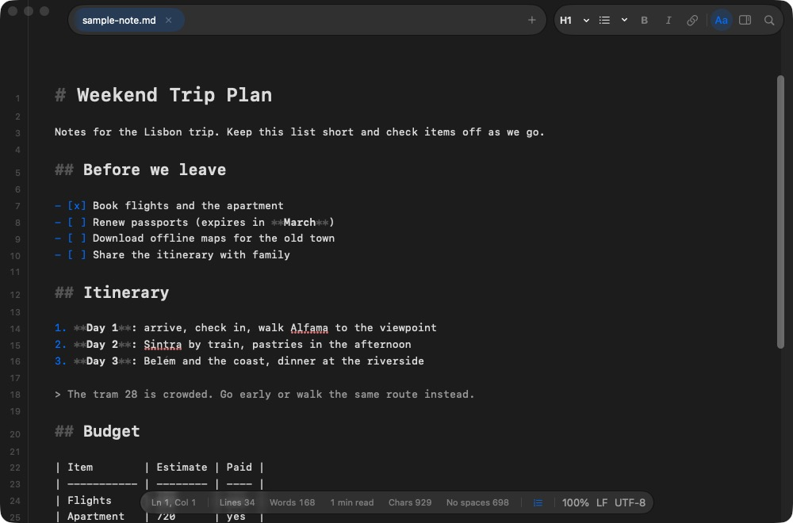
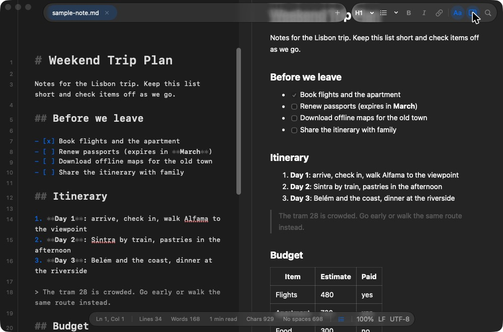
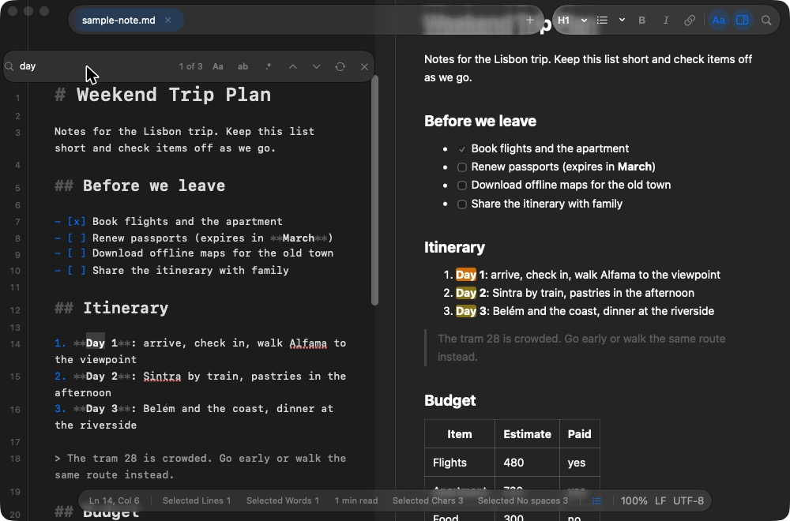
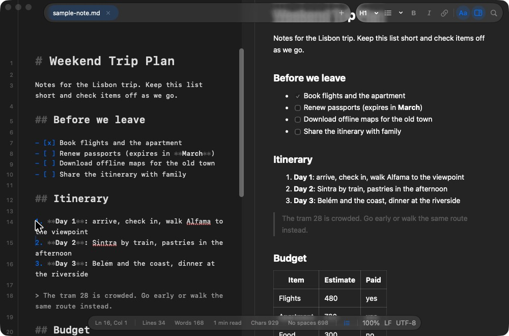
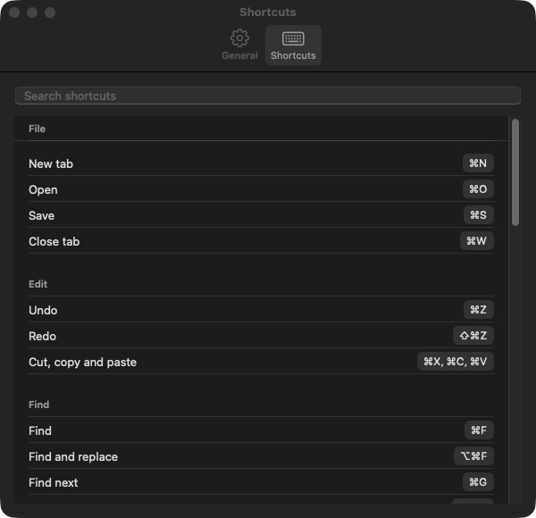
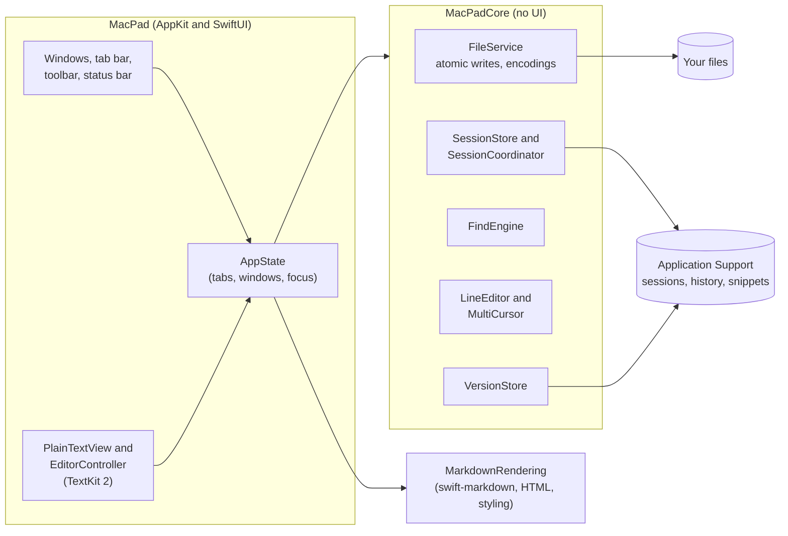
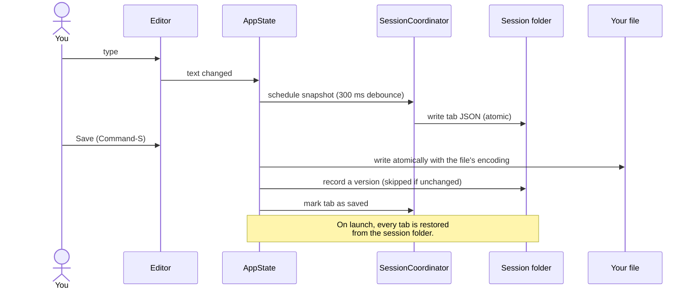
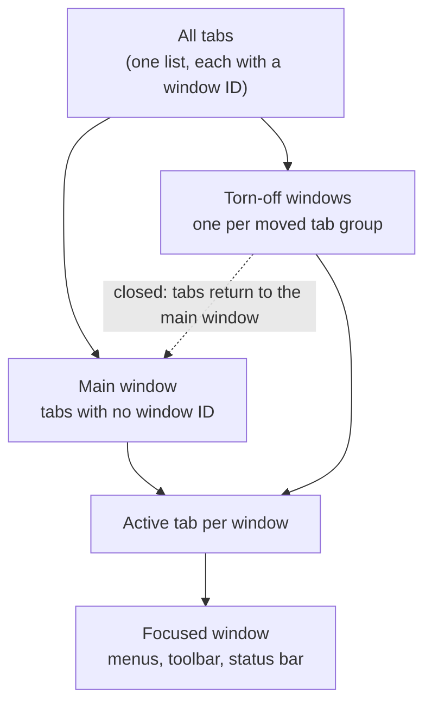

# MacPad

**A native text editor for macOS.** Plain text and Markdown in tabs, with multiple cursors, live Markdown preview, version history and a session that survives quits and crashes. Built with Swift, AppKit and SwiftUI.

MacPad is made for the Mac. It is not a port of Windows Notepad, although its layout is inspired by it. It runs on macOS 14 and later, and it does not run on Windows.



---

## Contents

- [Why MacPad](#why-macpad)
- [Screenshots](#screenshots)
- [Features](#features)
- [Keyboard shortcuts](#keyboard-shortcuts)
- [Install](#install)
- [How it works](#how-it-works)
- [Build from source](#build-from-source)
- [Test and release](#test-and-release)
- [Project layout](#project-layout)
- [Contributing](#contributing)
- [License](#license)

## Why MacPad

- **Your text is never lost.** Every tab, including unsaved text, is written to disk as you type and restored after a quit, a crash or a restart.
- **Built for the Mac.** Liquid Glass chrome on macOS 26 and later, a system-material fallback on older releases, Services, Share, Focus Mode, a Dock badge and VoiceOver labels.
- **Writes Markdown and plain text well.** Live formatting in the editor, a split preview that follows your scrolling, and export to HTML or PDF.
- **Fast with many cursors.** Multiple cursors work the way they do in VS Code, and they edit every line at once.

## Screenshots

| Editing Markdown | Split view with preview |
| --- | --- |
|  |  |
| **Find highlights in both panes** | **Multiple cursors** |
|  |  |

## Features

### Files and tabs

- Open any text or Markdown file in tabs. Drag a file onto the window, or use File > Open.
- Drag a tab sideways to reorder it, or drag it out of the tab strip to open it in its own window.
- Each window keeps its own tabs and active tab. Torn-off windows reopen after a restart.
- Encodings: UTF-8, UTF-8 with BOM, UTF-16 and Windows-1252. Line endings: LF, CRLF and CR. Both are detected on open and can be changed from the status bar.
- Read-only files open with a banner and a Save As button.
- Files changed on disk are noticed. You can keep your version, reload, or save a copy.

### Editing

- Formatting toolbar and shortcuts for bold, italic, links, headings and lists.
- Line commands: duplicate, move up or down, join, sort and remove duplicate lines.
- Snippets and templates, with `{date}`, `{time}` and `{cursor}` placeholders. Save any selection as a snippet.
- Spell checking from the system, with your own dictionary.
- Zoom with Command and scroll, or with the keyboard.
- Focus Mode hides the chrome and centres the text.

### Multiple cursors

| Action | Shortcut |
| --- | --- |
| Add or remove a cursor where you click | Option-click |
| Add a cursor above or below | Command-Option-Up or Down |
| Select the next occurrence of the selection | Command-D |
| Column (box) selection | Shift-Option-drag |
| Back to one cursor | Click or Escape |

With several cursors, typing, Space, Return, Tab, Backspace, Delete, arrow keys, paste, copy and cut all apply at every cursor, as one undo step.

### Markdown

- Formatted view styles headings, emphasis, lists, quotes, code and links as you type.
- A live preview opens beside the editor. It follows your scrolling, and clicking a heading in the preview moves the editor to it.
- Find highlights matches in the preview as well as the editor.
- Export to HTML or PDF with the same styling as the preview.

### Find and replace

- Find, Find and Replace, Find Next and Find Previous, with match case, whole word and regular expressions.
- Regular expressions support capture groups in the replacement.
- The find bar stays open when you switch tabs.
- Go to Line.

### Safety

- **Session restore.** Unsaved text is kept until you close its tab.
- **Set-aside tabs.** A session file that cannot be read is moved aside, and Recover Set-Aside Tabs brings its text back.
- **Version history.** Each save keeps a copy of the file, up to 50 copies or 20 MB per file. Browse them and restore one as an undoable edit. Nothing changes on disk until you save.
- **One prompt for many tabs.** Closing several tabs with unsaved changes asks once.

### Mac integration

- Share a tab from the File menu.
- Services: select text in any app and choose Open Selection in MacPad.
- A Dock badge shows how many tabs have unsaved changes.
- Liquid Glass on macOS 26 and later, with a material fallback on macOS 14 and 15.
- VoiceOver labels for the toolbar, tabs and status bar.

## Keyboard shortcuts

Open **MacPad > Settings** (Command-comma), then the **Shortcuts** pane, to see every shortcut with a search box. **Help > Keyboard Shortcuts** opens the same pane.



The most used shortcuts:

| Task | Shortcut |
| --- | --- |
| New tab | Command-N |
| Open | Command-O |
| Save | Command-S |
| Close tab | Command-W |
| Next or previous tab | Command-Shift-] or [ |
| Tab 1 to 9 | Command-1 to 9 |
| Find | Command-F |
| Find and replace | Command-Option-F |
| Find next or previous | Command-G, Command-Shift-G |
| Go to line | Command-L |
| Bold, italic, link | Command-B, Command-I, Command-K |
| Heading 1 to 6 | Command-Option-1 to 6 |
| Bulleted or numbered list | Command-Shift-8, Command-Shift-7 |
| Duplicate line | Command-Shift-D |
| Move line up or down | Option-Up, Option-Down |
| Join lines | Command-J |
| Toggle Markdown preview | Command-Shift-P |
| Toggle formatted view | Command-Shift-F |
| Toggle word wrap | Command-Option-W |
| Focus Mode | Command-Shift-Return |
| Zoom in, out, actual size | Command-=, Command--, Command-0 |

## Settings

MacPad > Settings (Command-comma) has two panes:

- **General:** the editor font and size, wrapping long lines by default, and Markdown styling for plain text files.
- **Shortcuts:** every shortcut and mouse gesture, grouped by what it does, with search.

## Install

1. Go to the [Releases page](https://github.com/jadhavgaurav/NotePad/releases) and download the latest `MacPad-<version>-macos.dmg`.
2. Open the DMG and drag **MacPad** onto the **Applications** shortcut.
3. Open MacPad from Applications. macOS says it could not verify MacPad, so click **Done** (not Move to Trash).
4. Allow it once:
   - Open **System Settings > Privacy & Security**, scroll to the message about MacPad, click **Open Anyway**, then enter your password.
   - Or run this in Terminal, then open MacPad again:

     ```bash
     xattr -dr com.apple.quarantine /Applications/MacPad.app
     ```

You only need to do this once. Each release also has a `.sha256` checksum file. To check a download:

```bash
shasum -a 256 -c MacPad-<version>-macos.dmg.sha256
```

MacPad is not yet signed with an Apple Developer ID or notarized by Apple, which is why macOS shows this warning.

**Requirements:** macOS 14 or later.

## How it works

### Architecture

MacPad has three modules. The core holds the logic with no UI, so it can be tested on its own.



### Saving and session restore

Every edit is saved to the session folder within a fraction of a second, so unsaved text survives a quit or a crash. Saving a file writes it atomically, then records a version.



### Windows and tabs

Tabs belong to windows. The main window opens at launch, and a torn-off tab opens its own window. Menus act on the focused window.



## Build from source

You need the Swift toolchain from Xcode or the Command Line Tools.

```bash
swift build                    # debug build
Scripts/bundle.sh release      # builds build/MacPad.app
open build/MacPad.app
```

## Test and release

```bash
swift test
```

Releases are built by the `Release` workflow. Push a version tag, and the workflow tests the code, builds the app, and attaches the DMG, the zip and their checksums to a new GitHub release.

```bash
git tag v1.4.0
git push origin v1.4.0
```

You can also run the workflow by hand from the Actions tab to produce a build without publishing a release.

## Project layout

- `Sources/MacPadCore`: file I/O, sessions, find, line editing, multiple cursors, version history (no UI)
- `Sources/MarkdownRendering`: Markdown to HTML, the preview script and styling
- `Sources/MacPad`: the AppKit editor and the SwiftUI interface
- `Tests/`: unit tests for the core and rendering modules
- `Scripts/`: `bundle.sh` builds the app, `make-icon.swift` draws the icon
- `docs/`: design notes, the feature plan, the verification log and images

## Contributing

Read [CONTRIBUTING.md](CONTRIBUTING.md) first. For anything bigger than a small fix, open an issue to agree on the approach.

## License

MIT. See [LICENSE](LICENSE).
